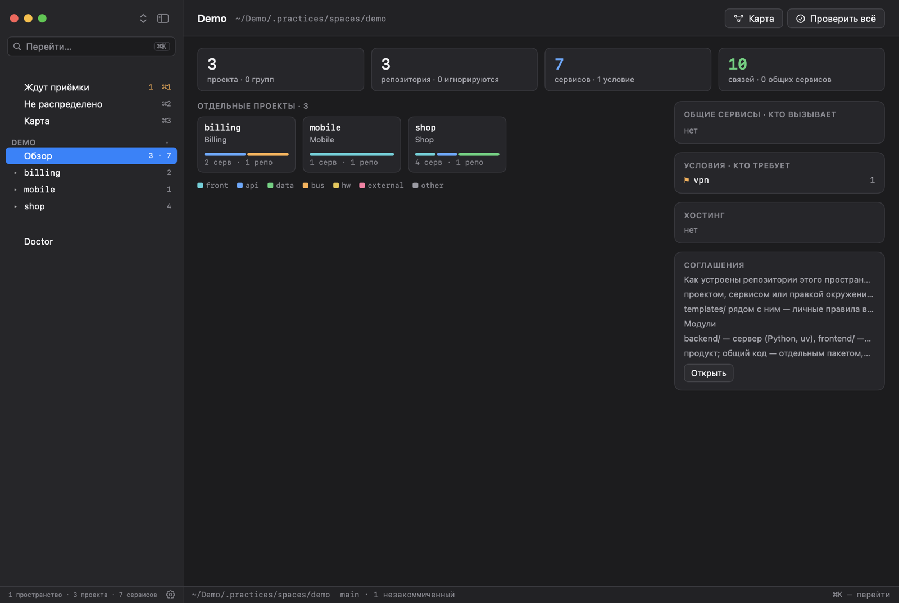
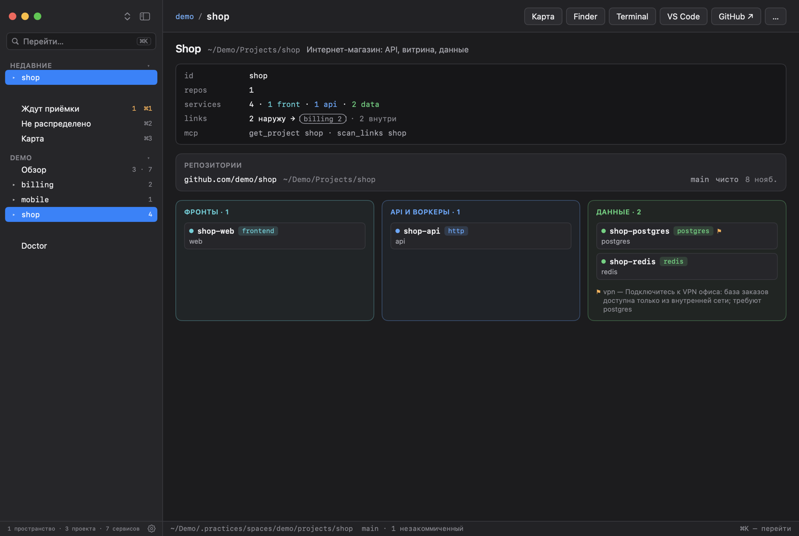
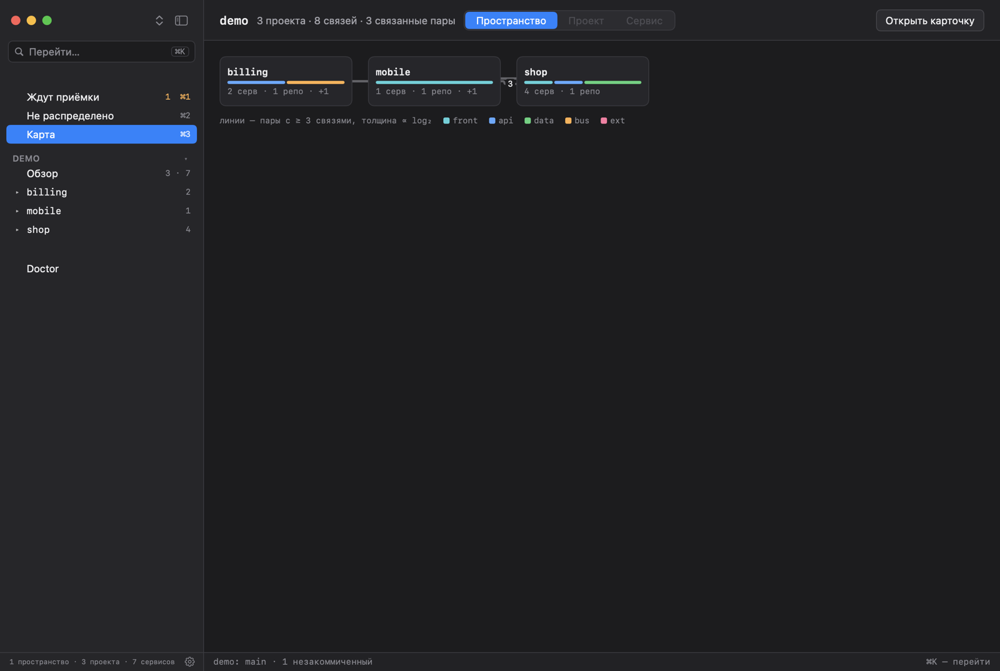
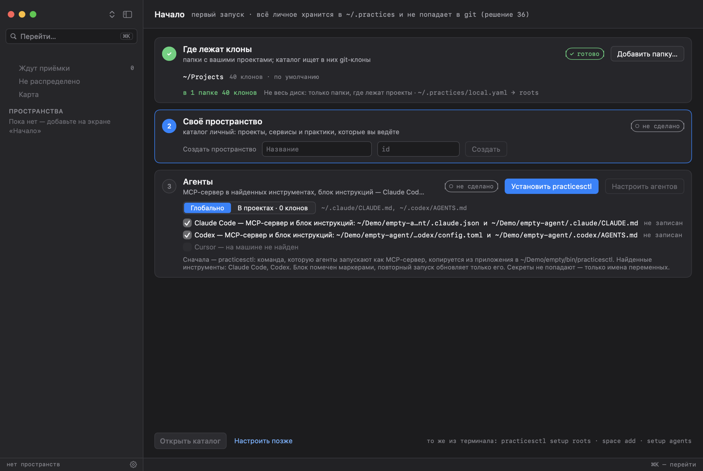
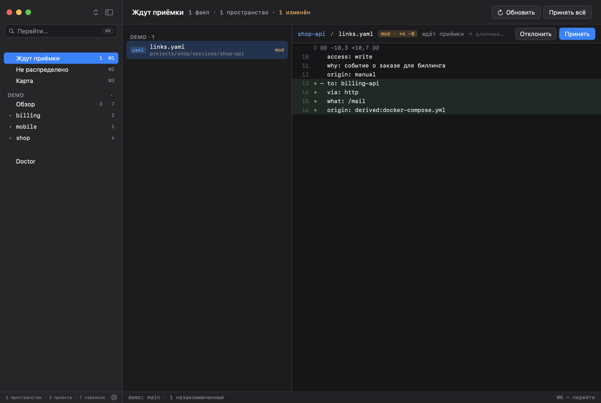
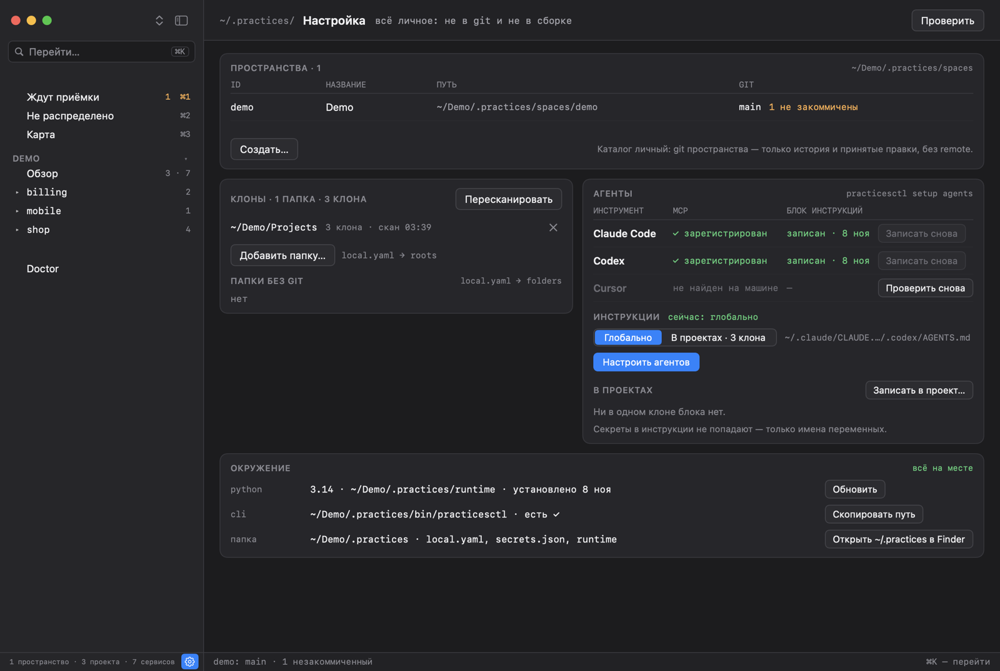

# Practices

## Что это

Practices — одно место, где описаны все проекты разработчика: что к чему относится, какой сервис
кого вызывает, где ключи, документация и готовый код запросов. Это личное приложение для macOS
(окно и значок в строке меню), CLI `practicesctl` и MCP-сервер. Первый читатель — агент, который
работает в проекте: он спрашивает каталог, прежде чем писать новый клиент к чужому сервису.

Только macOS (Apple Silicon). Версия под Windows когда-нибудь возможна, но сомнительна.

**Каталог.** *Пространство* (организация) содержит *проекты*, они вкладываются друг в друга; у
проекта — *репозитории* (по адресу remote) и *сервисы*: сервис compose из репозитория или внешняя
система (база, API, Kafka). У сервиса — адреса, имена ключей, именованные *условия* («нужна
корпоративная сеть»), заметки, словарь полей результата и *связи* с сервисами, которые он
вызывает. Каждое пространство — git-репозиторий в `~/.practices/spaces/`; значения секретов
лежат вне git, в `~/.practices/secrets.json`.

**Практики.** Под сервисом живут *практики* — именованные ячейки кода («данные устройства») с
кнопкой запуска, читаемым результатом (таблица, дерево JSON, текст), временем и историей версий;
*цепочки* их объединяют. Практики копируются в проекты; через MCP агент читает каталог и
присылает практики и связи как незакоммиченные правки, которые пользователь принимает сам.



*Обзор пространства: проекты, репозитории, сервисы и связи, общие сервисы и соглашения.*



*Карточка проекта: репозитории с локальными клонами и сервисы по ролям — фронты, API, данные.*



*Карта: проекты и связи между ними; линия — пара проектов с тремя и более связями.*

План и этапы — [`PLAN.md`](work/2026-11-06-catalog-rebuild/PLAN.md), решения и их альтернативы — [`DECISIONS.md`](work/2026-11-06-catalog-rebuild/DECISIONS.md).

## Установка из DMG

1. Скачайте `Practices-<версия>.dmg` со страницы
   [Releases](https://github.com/Anato-Lich/Practices/releases), откройте и перетащите Practices в
   Applications.
2. Приложение не подписано Developer ID и не нотаризовано, поэтому первый запуск покажет
   *«Practices» не открыто — Apple не удалось проверить…*. Нажмите **Готово**, откройте
   **System Settings ▸ Privacy & Security**, найдите *«Practices» заблокировано…* и нажмите
   **Open Anyway** (один раз на установку). Или в терминале:
   ```sh
   xattr -dr com.apple.quarantine /Applications/Practices.app
   ```
CLI `practicesctl` (он же MCP-сервер) и `uv`, которым запускаются практики на Python, лежат внутри
приложения, в `Contents/Helpers`; отдельно их ставить не нужно. Сам Python uv скачивает при первом
запуске практики — для этого один раз нужна сеть. При первом запуске открывается экран «Начало» — три шага (то же
можно сделать из терминала командами `practicesctl setup …` или попросить агента в диалоге):

1. **Где лежат клоны** — папки с проектами (не весь диск); каталог ищет в них git-клоны и
   записывает их в `~/.practices/local.yaml → roots`. Пока папок нет, каталог клонов не ищет.
2. **Своё пространство** — каталог личный: проекты, сервисы и практики, которые ведёте вы.
3. **Агенты** — сначала **«Установить practicesctl»**: приложение копирует CLI и uv из себя в
   `~/.practices/bin` (по этому пути агенты запускают MCP-сервер) и ставит ссылку
   `~/.local/bin/practicesctl`. Затем **«Настроить агентов»**: MCP-сервер в найденных инструментах
   (Claude Code, Codex, Cursor) и блок инструкций — глобально или в каждый проект, решаете вы.



*Первый запуск: папки с клонами, своё пространство, агенты — по шагу на каждое.*

Копию в `~/.practices/bin` приложение обновляет само: при запуске сравнивает её со своей и, если
она устарела, ставит заново. Вручную — «Настройка» → «Окружение» → «Переустановить».

## Сборка из исходников

Нужны Xcode (`sudo xcode-select -s /Applications/Xcode.app`) и `xcodegen` — `install.sh` ставит
его через Homebrew, если нет. Homebrew нужен только для сборки: uv приходит с приложением (сборка
скачивает закреплённую версию в `build/uv`, `tools/fetch-uv.sh`).

```sh
git clone https://github.com/Anato-Lich/Practices && cd Practices
./install.sh
```

`install.sh` **заменяет установленное** и сначала печатает, что именно: собирает приложение в
Release, кладёт `practicesctl`, его ресурсы и `uv` из `Contents/Helpers` собранного приложения в
`$PRACTICES_HOME/bin` (по умолчанию `~/.practices/bin`, поверх прежнего, ссылка — в
`~/.local/bin`), закрывает запущенную копию, удаляет `/Applications/Practices.app`, ставит новую и
открывает её и кладёт ярлык Practices на рабочий стол. Данные в `~/.practices` (пространства,
`local.yaml`, секреты) не трогает.

`tools/release.sh` собирает Release и упаковывает его в `dist/Practices-<версия>.dmg` — это
единственный артефакт релиза, CLI внутри приложения. Подпись ad-hoc, без Developer ID и
нотаризации: `spctl --assess` такое приложение отвергает, поэтому у скачавшего нужен шаг с
карантином из раздела «Установка из DMG».

| Команда | Что |
|---|---|
| `./install.sh` | Release в `/Applications` и CLI в `~/.practices/bin` |
| `tools/release.sh` | `dist/Practices-<версия>.dmg` с CLI внутри, печатает путь и sha256 |
| `./run.sh` | Debug-сборка и запуск, без установки |
| `tools/build-dev.sh` | Debug-сборка одними Command Line Tools, когда `xcodebuild` недоступен |
| `cd PracticesCore && swift run practicesctl spaces` | CLI из исходников |

Один CLI без приложения: `cd PracticesCore && swift build -c release && .build/release/practicesctl
setup install` (или кнопка «Установить practicesctl» в приложении). `setup install` копирует
запущенный бинарник с его ресурсами в `~/.practices/bin`, а `uv` — лежащий рядом или из
установленного приложения; без приложения uv ищется в обычных путях (`/opt/homebrew/bin` и др.).

Только для разработки. Debug-сборка понимает флаги рендера: окно рисуется вне экрана в PNG, и
приложение выходит; Release их отвергает («render flags are available in Debug builds only»).

```sh
export DEVELOPER_DIR=/Applications/Xcode.app/Contents/Developer
(cd PracticesApp && xcodegen generate)
xcodebuild -project PracticesApp/Practices.xcodeproj -scheme Practices -configuration Debug \
  -derivedDataPath build build
build/Build/Products/Debug/Practices.app/Contents/MacOS/Practices --render-window out.png \
  [--welcome | --settings | --pending | --doctor | --space <id> | --project <id> | --map …] [--wait 2]
  # карта: --map --project <id> | --space <id> [--flow] | --service <id> [--hops n]; --zoom k, --pin <id>
```

Для изолированного запуска `PRACTICES_HOME` подменяет `~/.practices`, а `PRACTICES_AGENT_HOME` —
домашнюю папку агентских инструментов (`~/.claude`, `~/.claude.json`, `~/.codex`, `~/.cursor`),
чтобы рендеры и тесты не трогали настоящие файлы; CLI и MCP понимают обе переменные. Скриншоты в
`docs/images` сняты так на демо-каталоге.

Тесты (Swift Testing): с выбранным Xcode — `cd PracticesCore && swift test`. С одними Command Line
Tools укажите компилятору фреймворк Testing:

```sh
F=/Library/Developer/CommandLineTools/Library/Developer/Frameworks
swift test -Xswiftc -F -Xswiftc $F -Xlinker -F -Xlinker $F -Xlinker -rpath -Xlinker $F \
  -Xlinker -rpath -Xlinker /Library/Developer/CommandLineTools/Library/Developer/usr/lib
```

| Путь | Что |
|---|---|
| `PracticesCore/` | Swift-пакет: ядро без UI и CLI `practicesctl` |
| `PracticesApp/` | приложение SwiftUI, генерируется `xcodegen` из `project.yml` |
| `tools/` | сборка, иконка, прототип карты |

## Первые шаги

Пример: в `~/Projects/shop` лежит клон с `origin` на GitHub, в нём

```
docker-compose.yml   # services: api (build: .), db (image: postgres:16)
.env.example         # DATABASE_URL=postgres://db:5432/shop, BILLING_URL=https://billing.example
```

```sh
practicesctl setup status                          # что уже настроено
practicesctl roots add ~/Projects/…                # где лежат клоны (= setup roots)
practicesctl space add <id> [--name N] [--hosting host/owner]   # своё пространство
            # --hosting необязательно; `repos` тогда спрашивает у gh/glab все репозитории владельца
practicesctl project add <space>/<id> [--parent p] # проект
practicesctl repos                                 # репозитории без проекта
practicesctl assign <repo> <project> [--role r]    # репозиторий — в проект
practicesctl scan <project> --write                # сервисы и связи из compose и example env
```

`scan` читает в клонах compose-файлы (сервисы: `api` станет `shop-api`, `db` — `shop-db`) и
связи из адресов и DSN — в `environment:` сервисов compose и в example env-файлах
(`.env.example`, `.env.sample`…); настоящий `.env` не открывается. `depends_on` связью не считается:
это порядок запуска, а не вызов. В примере: `shop-api → shop-db` и неизвестный `billing.example`.

`scan --write` и агенты через MCP не коммитят: правки ждут приёмки — `practicesctl pending`,
`practicesctl accept [space [path…]]`, или экран приёмки в окне (принять всё, отклонить файл).



*Приёмка: новая связь из `scan --write` ждёт решения — принять или отклонить файл.*

Агентам — MCP-сервер и блок инструкций:

```sh
practicesctl setup agents --global     # ~/.claude/CLAUDE.md и ~/.codex/AGENTS.md
practicesctl setup agents --projects   # CLAUDE.md и AGENTS.md каждого клона проектов каталога
```

Регистрация MCP — в `~/.claude.json`, `~/.codex/config.toml`, `~/.cursor/mcp.json` для найденных
инструментов. Вручную для Claude Code:
`claude mcp add --scope user practices -- ~/.practices/bin/practicesctl mcp`. Агент спрашивает,
куда писать, прежде чем вызывать `setup_agents`. То же — в окне, в «Настройке» (шестерёнка внизу
боковой панели).



*Настройка: пространства, папки с клонами, агенты и окружение (Python, CLI).*

`~/.claude.json` читается и записывается обратно целиком: содержимое сохраняется, но файл
переформатируется (отступы, ключи по алфавиту).

**Python.** Практики работают в своём окружении `~/.practices/runtime`: его файлы приходят с
приложением и CLI, а `uv sync` (uv из приложения) скачивает Python и собирает там `.venv` при первом
запуске практики (`practicesctl try`, MCP `run_practice`, кнопка запуска) или по «Настройка» →
«Окружение» → «Обновить»; при смене `pyproject.toml` в новой версии синхронизируется заново. До
этого «Настройка» пишет «python: будет установлен при первом запуске практики»; оранжевое «не
установлено» — только если uv не найден нигде.

**Doctor.** `practicesctl doctor` (и экран «Doctor» в окне) проверяет файлы под корнями клонов
против каталога: открытые значения сохранённых секретов в тексте (сообщает имена и пути, не
значения); `.env` с ключами каталога, но другими значениями; `.env`, целиком повторяющие каталог (их
заменяет `run`); одно секретное значение в нескольких `.env`, которого каталог не знает; висящие
связи — на сервисы, которых в каталоге нет. Код выхода 1 при LEAK — можно ставить в pre-commit.

Новое пространство получает `conventions.md` и `templates/` по умолчанию — правила ведения
репозиториев, которые агенты читают через MCP `get_conventions` (`practicesctl conventions <space>
[--templates]`). Правьте их под себя.

## Справка practicesctl

`--json` у команд-списков печатает машиночитаемый вывод.

```
usage: practicesctl <command> [--json]

catalogue (~/.practices/spaces/<space>, one git repository per space):
  spaces                        spaces: path, branch, uncommitted (the catalogue is personal:
                                each space is a local git repository, never shared)
  space add <id> [--name N] [--hosting host/owner …]
  projects [space]              the tree of projects with their repositories and services
  project <id>                  one project: repositories (role, local clone), services, chains
  project add <space>/<id> [--parent <project>] [--name N] [--description D]
  project hosts <id> [<condition>…]   the servers it is deployed on: conditions of its space
                                (none given — clears the list)
  conventions <space> [--templates]   the owner's rules for repositories (conventions.md) and
                                the paths of templates/ (--templates: with their contents)
  repos [--all]                 not assigned to any project: from gh / glab by the spaces'
                                hosting, plus local clones (--all: ignored ones too)
  assign <repo> <project> [--role r]     repo = a remote address in any form
  unassign <repo>
  remove-project <id> [--keep-repos]   delete a project and its services; its repositories go to the
                                space's ignore list unless --keep-repos (refused while it has child projects)
  ignore <repo> [--space id]    keep a repository out of `repos` (the space is the one whose
  unignore <repo> [--space id]  hosting lists it, unless given)
  services [project]            services, their environments and key status
  service <id>                  one service: endpoints, conditions, links, keys, notes, docs
  service add <id> --project <p> [--name N] [--kind k] [--description D] [--repo r]
                                [--alias a …] [--env e …] [--key K …]
  service role <id> [role]      its role on the map (front bff backend processing worker infra
                                ingest relay device ops external); without one — the role
                                and whether it is set or inferred; written, not committed
  links [service]               who calls whom (of one service: both directions)
  link add <from> <to> [--endpoint e] [--env e] [--via http|topic|db|network|build]
                                [--what w] [--access read|write] [--why w] [--practice ref]
                                [--file f] [--as VAR=KEY …] [--origin o] [--no-commit]
                                --origin: manual (default), code:<file> where the call is seen
                                (what agents pass); --no-commit leaves it for `accept`
  link reject <from> <to> [--via v] [--what topic] --why "…" [--origin o] [--no-commit]
                                the link was checked and is false: it leaves links.yaml, goes to
                                rejected.yaml, and `scan` no longer offers it (origin: manual,
                                code:<file>, audit:<report>)
  link unreject <from> <to> [--via v] [--what topic] [--no-commit]
  conditions [space]            named conditions and who requires them
  condition add <space>/<id> --name N [--hint H] [--reachable TEMPLATE]
                                TEMPLATE = host:port over the service's keys, e.g. '${PG_HOST}:${PG_PORT}'
  scan [project | repo]… [--write] [--all]   services and links the clones' compose files and
                                example env files give, against the catalogue (default: every
                                assigned clone); --write leaves the new ones uncommitted for
                                `accept`; links refused before are counted, --all lists them
  pending                       uncommitted changes in the spaces (an agent's edits)
  accept [space [path…]] [--message m]   commit them: all, one space's, or the given files
  discard <space> <path…>       drop them: a new file is deleted, an edited one restored

values and checks:
  check [ref…]                  endpoints and conditions of services (all by default)
  secrets set <id> <KEY> [--env e]    value read from stdin, never from arguments
  secrets unset <id> <KEY> [--env e]
  secrets import <id>@<env> [--from <.env>] KEY=THEIR_KEY | KEY:=value | KEY=env:<other env> …
                                fill an environment (adding it if new); values are never printed
  env <ref…>                    names of the variables `run` would set (no values)
  run <ref…> -- <command…>      run a command with the services' values in its environment
  doctor                        .env files and plain text under the search roots against the registry
  connect <ref…> --to <file> [--project dir] [--as VAR=KEY…] [--only KEY,KEY]
                                write services' values into a project's env file, once;
                                refuses files git would commit (--force)

  ref = <service>[@<env>]

practices:
  practices [service]           practices and chains
  sig <practice>                parameters of a practice's run()
  try <practice> [k=v…] [--env service=env…] [--rows N]
                                run it and print the result (a table, a tree or text)
  runs <practice>               its run history: version, time, rows
  search <text>                 services (id, name, kind, alias, description), fields, practices
                                whose result has it, docs, code
  copies [practice]             copies under the search roots found by their marker: current / outdated / modified

this machine (~/.practices/local.yaml, agents' settings; never in git):
  roots                         folders where clones are looked for, with the clones found
  roots add <path>… | roots remove <path>
  setup status [--json]         roots, spaces, agents: MCP registered,
                                instruction block absent / current / outdated, project clones with it
  setup roots <path>…           = roots add, for the first run
  setup install                 copy this practicesctl (with its bundle, and uv from beside it or
                                the app) into ~/.practices/bin, linked from ~/.local/bin
  setup agents --global | --projects [--tools claude,codex,cursor] [--no-mcp] [--no-instructions]
                                register the MCP server for the tools found (~/.claude, ~/.codex,
                                ~/.cursor) and write the instruction block: --global into
                                ~/.claude/CLAUDE.md and ~/.codex/AGENTS.md, --projects into CLAUDE.md
                                and AGENTS.md of every clone of the catalogue's projects;
                                with neither, asks (in a terminal)
  setup agents --project <id>   the block into CLAUDE.md and AGENTS.md of the project's clones

agent:
  mcp                           MCP server on stdin/stdout

  practice = <service>/<name> | chains/<name>
```

## Передача другому человеку

Передаётся только приложение (DECISIONS 36: общее — в git, личное — на машине). В git — код
приложения. Всё остальное у каждого своё и в сборку не попадает:

- пространства в `~/.practices/spaces/` — локальные git-репозитории без remote (история и
  приёмка правок агентов); между людьми не синхронизируются, из них ничего не копируется;
- `~/.practices/local.yaml` (корни клонов), `~/.practices/secrets.json`, окружение Python,
  история прогонов;
- регистрация MCP и блоки инструкций агентам;
- `conventions.md` и `templates/` пространства — личные правила владельца; новое пространство
  получает умолчания, дальше они ваши.

Новый человек ставит приложение из DMG (или `./install.sh`), на экране «Начало» добавляет папки
со своими клонами, создаёт своё пространство, ставит `practicesctl` и настраивает агентов.
Каталог наполняют `scan` и агенты; их правки ждут `accept`.
